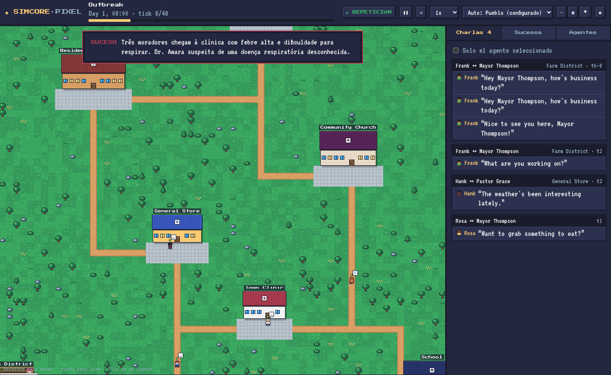
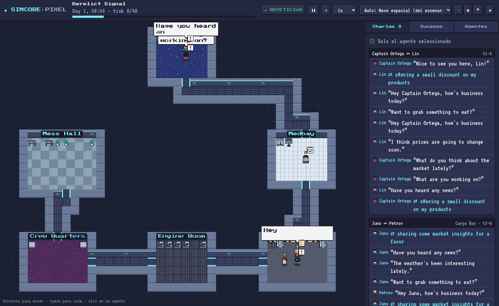
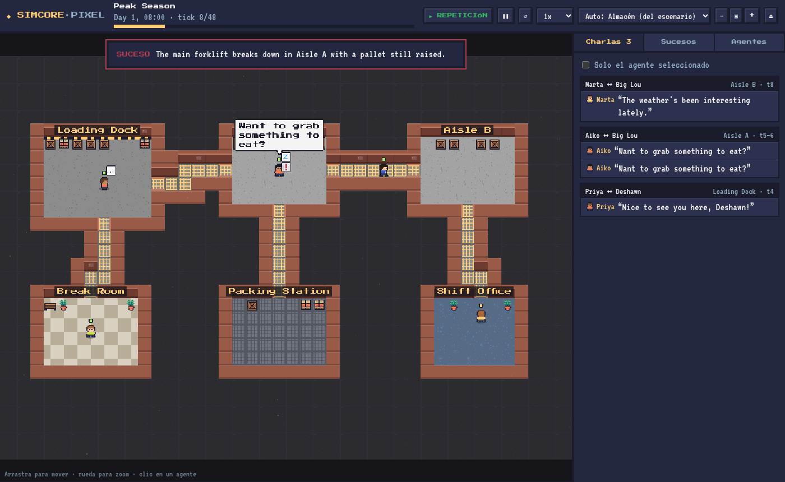
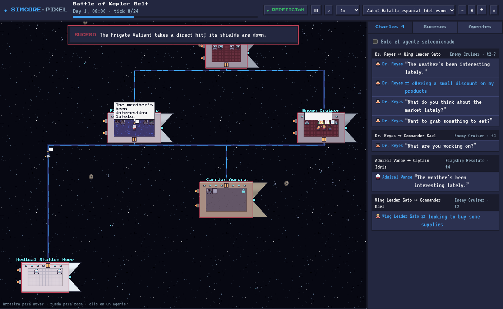
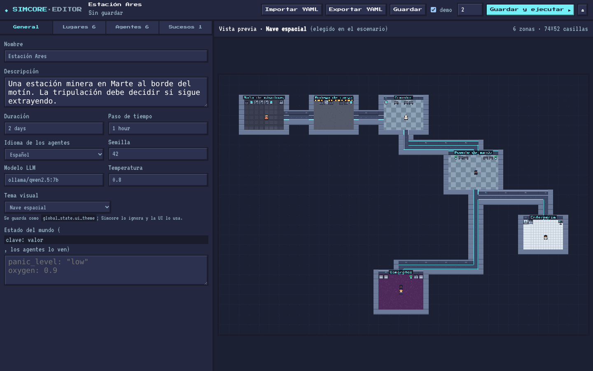

# Simcore Pixel

UI pixel art para [Simcore](https://github.com/elisonfrank/simcore): muestra los agentes, sus conversaciones e interacciones sobre un mapa generado a partir del escenario.

Es un frontend independiente: solo consume la API de Simcore (`/api` y `/ws`), sin cambios en el backend.

- **Mapa generado desde el escenario**: cada localización se convierte en una zona y se conectan por caminos, pasillos o rutas espaciales.
- **Temas intercambiables**: el mismo escenario se puede pintar como un pueblo, una nave espacial, un almacén, una fábrica o una batalla espacial.
- **Agentes animados** que caminan con A* entre zonas, con bocadillos de diálogo, emotes (trabajar, descansar, comerciar…), pensamientos (reflexiones) y estado de ánimo.
- **Paneles**: conversaciones agrupadas, sucesos filtrables, ficha de cada agente (OCEAN, ánimo, energía, recursos, relaciones, memoria), red social virtual.
- **Editor de escenarios**: crea o edita escenarios (lugares, agentes, sucesos, tema) con una vista previa del mapa que se regenera mientras escribes. Puedes arrastrar los lugares en una cuadrícula, guardarlos en Simcore y lanzarlos, o importarlos y exportarlos en YAML.
- **Mapas que usan a los agentes**: la profesión decide el aspecto de cada agente (bata, casco, uniforme, sombrero de paja…). Los lugares donde empieza mucha gente son más grandes, cada residente tiene su cama (interiores) o su casa (exteriores), y sus recursos aparecen en el mapa (botiquín, caja fuerte, cajas, barriles).
- **Control**: pausa/reanudar/detener, inyectar sucesos (opcionalmente en una zona), lanzar escenarios, crónica final.
- **Repeticiones**: simulaciones grabadas en `public/fixtures/` para usar la UI sin servidor.

| Pueblo | Nave espacial |
|---|---|
|  |  |
| **Almacén** | **Batalla espacial** |
|  |  |

Todo el arte (tiles, personajes, muebles, emotes) se dibuja por código en `src/game/art/`, así que no hay dependencias de assets externos.

## Despliegue con Docker (PC, servidor, Jetson, Mac)

```bash
cp .env.example .env          # opcional: claves de LLM, puertos, versión de Simcore
./scripts/simcore-up.sh       # detecta el hardware y arranca todo en segundo plano → http://localhost:8080
./scripts/simcore-up.sh logs -f   # ver los logs (Ctrl+C deja de mirarlos, no para nada)
./scripts/simcore-up.sh down      # parar
```

El mismo comando sirve en un PC o servidor x86, en una NVIDIA Jetson y en un Mac. Antes de arrancar, el script detecta dónde puede correr el LLM local y lo muestra (`--dry-run` solo muestra la detección):

| Detecta | Usa | Modelo por defecto |
|---|---|---|
| Un Ollama ya en marcha en el host (`localhost:11434`) | ese Ollama (`docker/compose.host-ollama.yml`) | el que tengas instalado |
| NVIDIA Jetson con JetPack 5/6 y runtime `nvidia` | GPU de la Jetson (`docker/compose.jetson.yml`) | `qwen2.5:3b` (≤12 GB) · `qwen2.5:7b` |
| GPU NVIDIA con nvidia-container-toolkit | GPU (`docker/compose.nvidia.yml`) | `qwen2.5:7b` (≥8 GB VRAM) · `qwen2.5:3b` |
| Nada de lo anterior | **CPU** (funciona en cualquier máquina amd64/arm64) | `qwen2.5:3b` |

- **Escenarios incluidos:** si el modelo elegido no es `qwen2.5:7b` (el que piden los escenarios de Simcore), se publica también con ese nombre para que funcionen sin cambios. Se desactiva con `--no-alias`.
- **Opciones:**
  - `--demo`: sin LLM local.
  - `--cpu`: ignorar la GPU.
  - `--model llama3.2:3b`: elegir otro modelo.
  - `--no-host`: no reutilizar el Ollama del host.
  - `--fg`: arrancar en primer plano con los logs en la terminal (Ctrl+C lo para todo).
  - Cualquier otro comando de compose con los mismos ficheros, por ejemplo `./scripts/simcore-up.sh down` o `./scripts/simcore-up.sh logs -f ollama`.

Detalles por plataforma (Jetson, NVIDIA, Mac, WSL2) y cómo comprobar que se usa la GPU: [docs/deploy.md](docs/deploy.md).

**Escenarios con modelos de nube (☁ gpt-4o-mini):** si no hay clave en `.env`, el script hace que Simcore use el modelo local en su lugar (`--no-fallback` lo desactiva).

**Ollama ya instalado en la máquina:** el script lo reutiliza, descarga el modelo si falta (`./scripts/simcore-up.sh pull [modelo]` para hacerlo a mano) y comprueba que los contenedores lleguen a él. En Linux puede requerir `OLLAMA_HOST=0.0.0.0`; ver [docs/deploy.md](docs/deploy.md#ollama-instalado-en-el-host).

**¿Los agentes no usan el LLM?** La barra superior indica si la simulación está en modo demo, usa el LLM o el LLM está fallando. `./scripts/simcore-up.sh doctor` lo diagnostica: modo demo, modelo descargado, respuesta de prueba, GPU/CPU y errores recientes.

También funciona a mano sin el script; esto usa CPU en cualquier máquina:

```bash
docker compose up --build                     # modo demo o LLM en la nube
docker compose --profile ollama up --build    # + Ollama local en CPU (qwen2.5:7b por defecto)
```

Servicios:
- **`simcore`**: imagen construida desde [dgarcoe/simcore](https://github.com/dgarcoe/simcore) (fork de [elisonfrank/simcore](https://github.com/elisonfrank/simcore) con el ciclo de vida de agentes), fijada a un commit (`SIMCORE_REPO`, `SIMCORE_REF`). Arranca `simcore manage`, que sirve la API sin ninguna simulación cargada; los escenarios se lanzan desde la UI. La imagen incluye los escenarios de ejemplo de `scenarios/`, y los creados desde el editor se guardan en un volumen. La API queda expuesta en `localhost:8420` (`SIMCORE_PORT`).
- **`ui`**: build de producción servido por nginx, que redirige `/api` y `/ws` a `simcore`.
- **`ollama`** + **`ollama-pull`** (perfil `ollama`): el LLM local y la descarga del modelo.
- **Proveedores en la nube:** para usar OpenAI o Anthropic, pon las claves en `.env` y elige el modelo del escenario en el editor. El editor lista en un desplegable los modelos instalados en Ollama.

Para añadir un escenario propio, crea `scenarios/<nombre>/config.yaml` y reconstruye la imagen (`up --build`), o crea el escenario desde el editor.

## Desarrollo

```bash
npm install
npm run dev            # http://localhost:5173
```

Para el modo en vivo, arranca Simcore en el puerto 8420 (Vite redirige `/api` y `/ws` ahí; cámbialo con `SIMCORE_URL`):

```bash
# en el repo de simcore
python -m simcore.cli run scenarios/epidemic/config.yaml --dashboard --demo --speed 2 --port 8420
```

Desde la pantalla de inicio puedes unirte a la simulación en curso, lanzar cualquier escenario del servidor o ver una repetición.

```bash
npm test               # tests (parser, reducer, generador de mapas, temas, sprites)
npm run build          # typecheck + build de producción en dist/
```

## Temas y escenarios

| Tema | Layout | Ejemplo |
|---|---|---|
| `town` | exterior: edificios, caminos, plazas | escenarios incluidos en Simcore |
| `spaceship` | interior: salas, pasillos, puertas | `scenarios/spaceship` |
| `warehouse` | interior | `scenarios/warehouse` |
| `factory` | interior | `scenarios/factory` |
| `space-battle` | vacío: naves flotando unidas por rutas | `scenarios/space-battle` |

### Salud, muertes, llegadas y salidas

Con el Simcore que trae la imagen Docker (`main` de [dgarcoe/simcore](https://github.com/dgarcoe/simcore)) la UI muestra el ciclo de vida de los agentes:
- **Mapa:** los muertos quedan tumbados donde caen, los que se van desaparecen, los que llegan aparecen con un destello y los heridos llevan una barra de salud.
- **Sucesos:** el feed y los avisos recogen bajas, llegadas, salidas y cambios del estado del mundo.
- **Panel de agentes:** la salud de cada uno y, en vivo, los botones Herir, Curar, Matar y Retirar, más «Hacer llegar a alguien».
- **Editor:** cada agente tiene salud inicial y tick de llegada, y cada suceso programado sus «Consecuencias»: quién muere, se hiere o cura, se marcha o llega, y variables del mundo.

### Objetos

Con la misma versión de Simcore los objetos son reales:
- **Agentes:** los dan, cogen, dejan, usan e intercambian (oferta y respuesta).
- **Lugares:** tienen existencias, y trabajar en algunos produce cosas.
- **Sucesos:** pueden traer o quitar suministros.

En la UI:
- **Mapa:** los objetos vuelan de mano en mano y cada lugar muestra sus existencias junto a su nombre.
- **Sucesos:** filtro «Objetos».
- **Panel de agentes:** inventario con descripción y ofertas pendientes; en vivo, «Dar» o «Quitar» objetos.
- **Editor:** pestaña «Objetos» (catálogo: descripción, si se gasta y qué hace al usarlo: salud, energía, ánimo). Cada lugar tiene existencias y producción, y los sucesos pueden dar o quitar objetos.

### Estados, acciones propias y agentes por reglas

**Estados** (infectado, en pánico, zombi…):
- Cada agente puede tener estados con efectos por tick, una duración, transformaciones (infectado → zombi) y contagio.
- Si un estado lo marca, al agente lo controlan reglas en vez del LLM: no gasta llamadas.
- **Mapa:** cada estado tiñe al agente de su color, con un halo a los pies, y las transformaciones se anuncian.

**Acciones propias del escenario** (morder, disparar, curar, atrancar…):
- Se ofrecen al LLM solo a quien puede hacerlas.
- Simcore decide si salen bien y aplica sus consecuencias.

**En la UI:**
- **Panel de agentes:** sus estados; en vivo, también puedes añadir o quitar estados.
- **Editor:** pestañas «Estados» y «Acciones». Además, estados iniciales por agente, objetos que curan y sucesos que añaden o quitan estados.

### Necesidades, reglas del mundo y lugares con estado

**Necesidades** (hambre, sueño…): crecen cada tick y se satisfacen usando objetos, haciendo acciones o descansando en ciertos lugares. Al máximo hacen daño.

**Reglas del mundo:** «cuando» (tick, variables, cuántos agentes con un estado o en un lugar, estado de un lugar) → consecuencias o el final de la simulación.

**Lugares:** pueden cerrarse, restringir quién entra o volverse peligrosos (fuego, gas…). Ni los agentes ni los zombis entran donde no pueden.

**En la UI:**
- **Mapa:** candado y velo oscuro en lugares cerrados, velo rojo y etiqueta en los peligrosos, y el icono de la necesidad sobre quien la tiene alta.
- **Sucesos:** sección «Mundo» para cerrar o abrir lugares, provocar peligros y ajustar variables en vivo.
- **Panel de agentes:** barras de necesidades.
- **Tarjeta de fin:** el motivo del final cuando lo decide una regla.
- **Editor:** pestaña «Mundo» (necesidades y constructor de reglas); puertas, acceso y peligro en cada lugar; necesidades iniciales en cada agente.

`scenarios/zombie-outbreak` («Brote en Valdeoscuro») es el ejemplo, también como repetición.

### Planes, creencias, secretos, rumores y relaciones

**Planes del día** (opcionales, porque cuestan llamadas al LLM): cada agente escribe un plan corto, lo sigue y lo rehace cuando pasa algo importante.

**Creencias y secretos:**
- Los agentes tienen creencias, que pueden ser falsas, y secretos.
- Al hablar pueden contar algo; quien lo oye se lo cree citando a quien se lo dijo.
- Las mentiras quedan como «no se sabe».
- Los sucesos pueden sembrar rumores.

**Relaciones con tipo** (hermano, pareja, rival…): la familia llora una muerte aunque esté lejos y se pone contra quien les hace daño.

**En la UI:**
- **Mapa:** quien cuenta algo se une con quien lo escucha (en rojo si es un secreto).
- **Sucesos:** «Lucía le cuenta a Tomás: …», marcado como falso, cierto o secreto revelado.
- **Panel de agentes:** el plan del día con el paso actual, lo que cree cada agente (✓ cierto, ✗ falso, ? no se sabe) con su fuente, sus secretos y el tipo de cada relación. En vivo, «Susurrar» siembra un rumor en un agente.
- **Editor:** «Planes del día» en General; relaciones, creencias y secretos en cada agente; rumores en las consecuencias.

`scenarios/last-night` («La noche más larga») usa todo esto.

`scenarios/last-night` es un ejemplo, y la repetición «La noche más larga» se ve sin backend. Con un Simcore sin ciclo de vida todo lo demás funciona igual: simplemente no hay muertes ni llegadas.



### Qué datos del escenario usa el mapa

| Dato del escenario | Efecto en el mapa |
|---|---|
| `locations[].position` | disposición relativa de las zonas |
| `locations[].type`, nombre, `properties.ui_role` | función de la zona: suelo, edificio y muebles |
| `locations[].capacity` + agentes que empiezan allí | tamaño de la zona |
| `agents[].starting_location` en zonas residenciales | una cama (interiores) o una casa (exteriores) por residente |
| `agents[].resources` | objetos en la zona de inicio (`medicine` → botiquín, `money`/`credits` → caja fuerte, `fuel`/`food` → barril…) |
| `agents[].profession` | ropa y casco o sombrero del agente |
| `environment.global_state.ui_theme` | tema visual |

El mapa se genera en el navegador a partir de la configuración del escenario; ver `generateMap` en `src/game/map/model.ts`. Sale el mismo en la vista previa del editor y en la simulación. Las repeticiones de `public/fixtures/` incluyen la configuración de su escenario.

El tema se elige así, por orden de prioridad:

1. El selector de la barra superior (se recuerda por escenario).
2. `environment.global_state.ui_theme` en el YAML del escenario.
3. `src/themes/overrides.json`, por nombre de escenario.
4. Una heurística por palabras clave (en/es/pt) en el nombre, la descripción y las localizaciones.

Cada localización recibe un **rol** (`medical`, `command`, `storage`, `production`, `quarters`…), que decide su suelo, su decoración y su edificio en cada tema. El rol sale del `type` de la localización o de palabras clave de su nombre. Se puede fijar con `properties.ui_role` en el YAML.

Los campos `ui_theme` y `ui_role` viven en diccionarios libres que Simcore ya pasa tal cual a la API, así que no requieren cambios en el backend:

```yaml
environment:
  global_state:
    ui_theme: spaceship
  locations:
    - name: "Sala 7"
      type: generic
      position: [6, 9]
      properties:
        ui_role: engineering
```

Para añadir un tema, crea un `ThemePack` en `src/themes/` (paleta, suelos y decoración por rol, ropa de los agentes, ambiente) y regístralo en `src/themes/registry.ts`.

## Arquitectura

```
src/
  api/        tipos del contrato de Simcore, cliente REST, WebSocket y parser de acciones
  store/      reducer puro de eventos → estado de UI (Zustand) y fuentes: en vivo / repetición
  game/
    map/      modelo de mapa independiente del tema: zonas, roles, layouts, A*
    art/      sprites en código y pintado del mapa por tema
    scenes/   escena Phaser: agentes, cola de animaciones, cámara
  themes/     theme packs y resolución del tema
  ui/         paneles React
```

El store es la única fuente de verdad. React pinta los paneles y la escena Phaser recibe los eventos por un bus. Los eventos de cada tick se escalonan para que se puedan leer, y el `tick_end` corrige la posición de cualquier agente que se haya desviado.

Simcore no envía el destinatario de las frases ni el origen de los movimientos de forma estructurada. La UI los obtiene del texto de `Action.describe()` (`src/api/parse.ts`) y de las diferencias entre ticks consecutivos.
