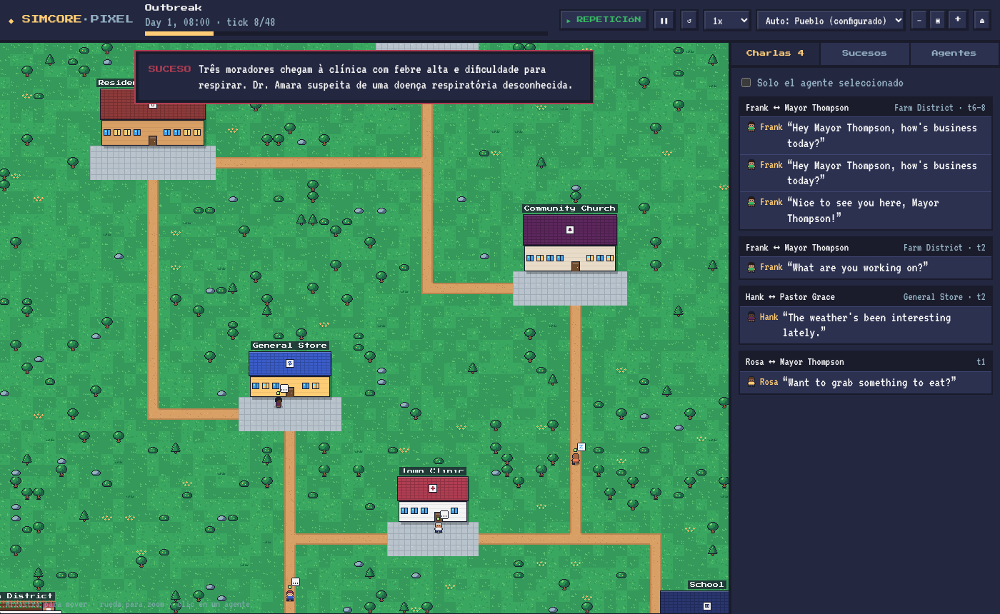
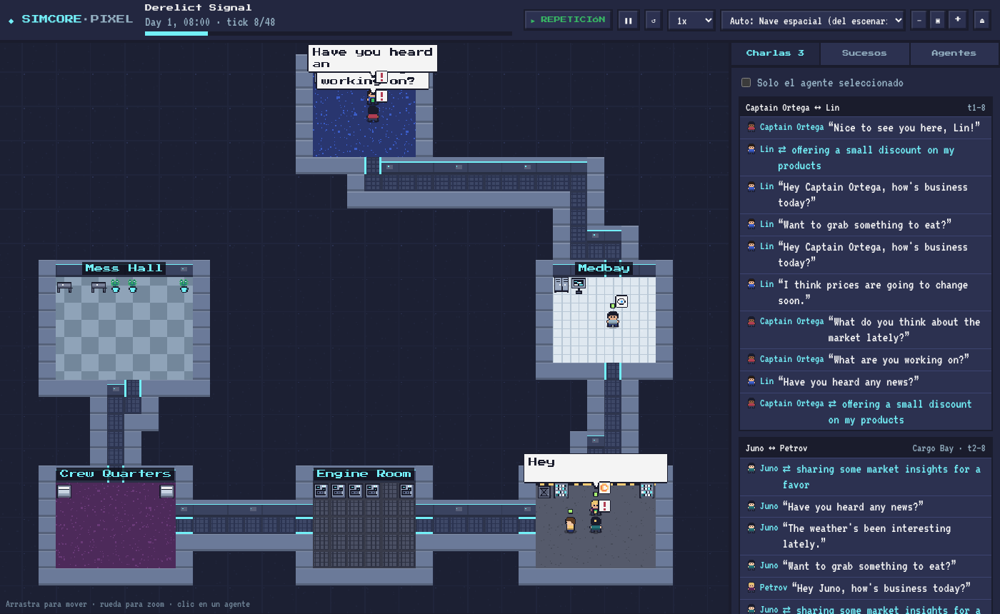
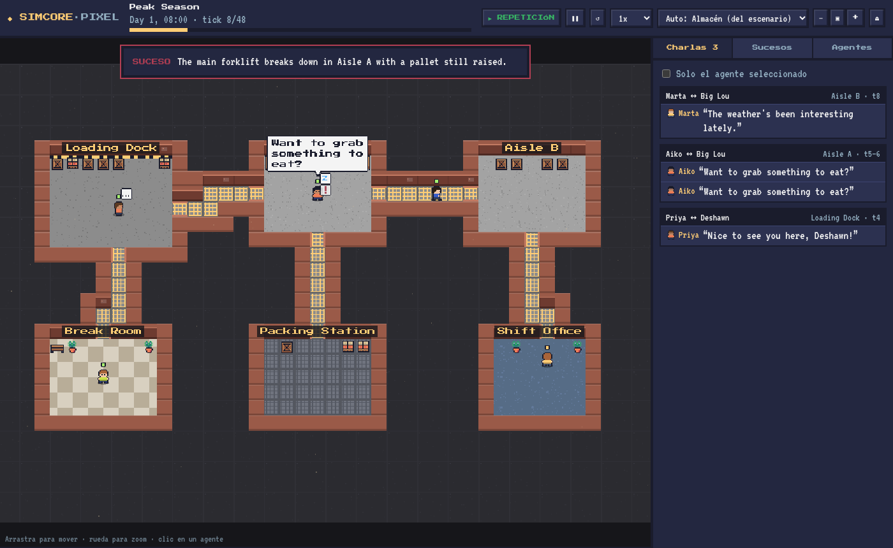
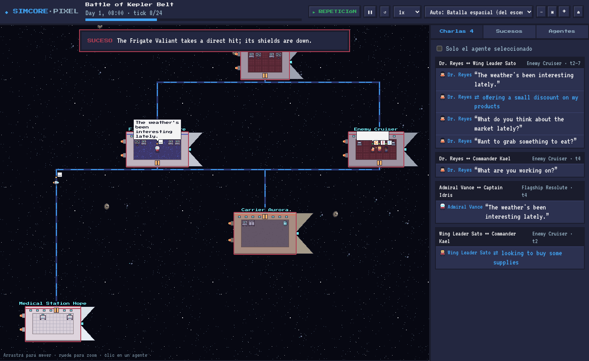
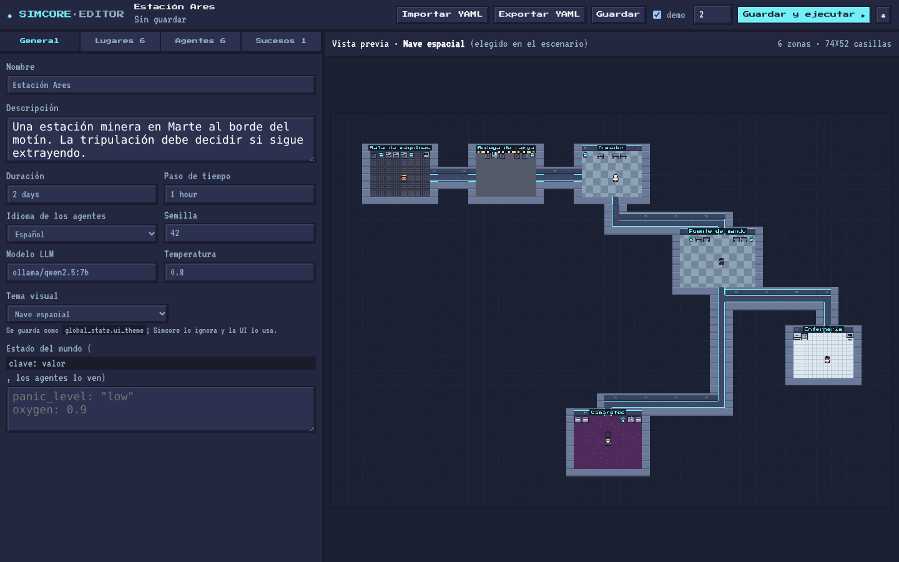

# Simcore Pixel

UI pixel art para [Simcore](https://github.com/elisonfrank/simcore): muestra los agentes, sus conversaciones e interacciones sobre un mapa generado a partir del escenario.

Es un frontend independiente: solo consume la API de Simcore (`/api` y `/ws`). Está pensado para el fork [dgarcoe/simcore](https://github.com/dgarcoe/simcore), fijado en `SIMCORE_REF` (`docker/simcore.Dockerfile`), que añade ciclo de vida, objetos, estados, reglas del mundo, conversaciones, sociedad, crónica y reglas de rol. Con el Simcore original también funciona, pero sin esas funciones.

- **Mapa generado desde el escenario**: cada localización se convierte en una zona y se conectan por caminos, pasillos o rutas espaciales.
- **Temas intercambiables**: el mismo escenario se puede pintar como un pueblo, una nave espacial, un almacén, una fábrica o una batalla espacial.
- **Agentes animados** que caminan con A* entre zonas, con bocadillos de diálogo, emotes (trabajar, descansar, comerciar…), pensamientos (reflexiones) y estado de ánimo.
- **Paneles**: conversaciones agrupadas, sucesos filtrables, ficha de cada agente (OCEAN, ánimo, energía, recursos, relaciones, memoria), red social virtual.
- **Editor de escenarios**: crea o edita escenarios (lugares, agentes, sucesos, tema) con una vista previa del mapa que se regenera mientras escribes. Puedes arrastrar los lugares en una cuadrícula, guardarlos en Simcore y lanzarlos, o importarlos y exportarlos en YAML.
- **Mapas que usan a los agentes**: la profesión decide el aspecto de cada agente (bata, casco, uniforme, sombrero de paja…). Los lugares donde empieza mucha gente son más grandes, cada residente tiene su cama (interiores) o su casa (exteriores), y sus recursos aparecen en el mapa (botiquín, caja fuerte, cajas, barriles).
- **Historia**: crónica por capítulos, momentos clave y grafo de relaciones a lo largo del tiempo, descargable.
- **Sociedad y rol**: grupos, votaciones, reputación, ataques y curas, fichas de personaje con tiradas de dado y niveles.
- **Control**: pausa/reanudar/detener, inyectar sucesos (opcionalmente en una zona), lanzar escenarios, crónica final.
- **Escenarios generados por un LLM**: [docs/escenarios-con-llm.md](docs/escenarios-con-llm.md) explica cómo pedirle a un LLM un escenario completo en YAML.
- **Repeticiones**: simulaciones grabadas en `public/fixtures/` para usar la UI sin servidor.

| Pueblo | Nave espacial |
|---|---|
|  |  |
| **Almacén** | **Batalla espacial** |
|  |  |

Todo el arte (tiles, personajes, muebles, emotes) se dibuja por código en `src/game/art/`, así que no hay dependencias de assets externos.

## Despliegue con Docker (PC, servidor, Jetson, Mac)

```bash
cp .env.example .env          # opcional: claves de LLM, puertos, versión de Simcore
./scripts/simcore-up.sh       # detecta el hardware y arranca todo en segundo plano → http://localhost:8080
./scripts/simcore-up.sh logs -f   # ver los logs (Ctrl+C deja de mirarlos, no para nada)
./scripts/simcore-up.sh down      # parar
```

El mismo comando sirve en un PC o servidor x86, en una NVIDIA Jetson y en un Mac. Antes de arrancar, el script detecta dónde puede correr el LLM local y lo muestra (`--dry-run` solo muestra la detección):

| Detecta | Usa | Modelo por defecto |
|---|---|---|
| Un Ollama ya en marcha en el host (`localhost:11434`) | ese Ollama (`docker/compose.host-ollama.yml`) | el que tengas instalado |
| NVIDIA Jetson con JetPack 5/6 y runtime `nvidia` | GPU de la Jetson (`docker/compose.jetson.yml`) | `qwen2.5:3b` (≤12 GB) · `qwen2.5:7b` |
| GPU NVIDIA con nvidia-container-toolkit | GPU (`docker/compose.nvidia.yml`) | `qwen2.5:7b` (≥8 GB VRAM) · `qwen2.5:3b` |
| Nada de lo anterior | **CPU** (funciona en cualquier máquina amd64/arm64) | `qwen2.5:3b` |

- **Escenarios incluidos:** si el modelo elegido no es `qwen2.5:7b` (el que piden los escenarios de Simcore), se publica también con ese nombre para que funcionen sin cambios. Se desactiva con `--no-alias`.
- **Opciones:**
  - `--demo`: sin LLM local.
  - `--cpu`: ignorar la GPU.
  - `--model llama3.2:3b`: elegir otro modelo.
  - `--no-host`: no reutilizar el Ollama del host.
  - `--fg`: arrancar en primer plano con los logs en la terminal (Ctrl+C lo para todo).
  - Cualquier otro comando de compose con los mismos ficheros, por ejemplo `./scripts/simcore-up.sh down` o `./scripts/simcore-up.sh logs -f ollama`.

Detalles por plataforma (Jetson, NVIDIA, Mac, WSL2) y cómo comprobar que se usa la GPU: [docs/deploy.md](docs/deploy.md).

**Escenarios con modelos de nube (☁ gpt-4o-mini):** si no hay clave en `.env`, el script hace que Simcore use el modelo local en su lugar (`--no-fallback` lo desactiva).

**Ollama ya instalado en la máquina:** el script lo reutiliza, descarga el modelo si falta (`./scripts/simcore-up.sh pull [modelo]` para hacerlo a mano) y comprueba que los contenedores lleguen a él. En Linux puede requerir `OLLAMA_HOST=0.0.0.0`; ver [docs/deploy.md](docs/deploy.md#ollama-instalado-en-el-host).

**¿Los agentes no usan el LLM?** La barra superior indica si la simulación está en modo demo, usa el LLM o el LLM está fallando. `./scripts/simcore-up.sh doctor` lo diagnostica: modo demo, modelo descargado, respuesta de prueba, GPU/CPU y errores recientes.

También funciona a mano sin el script; esto usa CPU en cualquier máquina:

```bash
docker compose up --build                     # modo demo o LLM en la nube
docker compose --profile ollama up --build    # + Ollama local en CPU (qwen2.5:7b por defecto)
```

Servicios:
- **`simcore`**: imagen construida desde [dgarcoe/simcore](https://github.com/dgarcoe/simcore) (fork de [elisonfrank/simcore](https://github.com/elisonfrank/simcore) con el ciclo de vida de agentes), fijada a un commit (`SIMCORE_REPO`, `SIMCORE_REF`). Arranca `simcore manage`, que sirve la API sin ninguna simulación cargada; los escenarios se lanzan desde la UI. La imagen incluye los escenarios de ejemplo de `scenarios/`, y los creados desde el editor se guardan en un volumen. La API queda expuesta en `localhost:8420` (`SIMCORE_PORT`).
- **`ui`**: build de producción servido por nginx, que redirige `/api` y `/ws` a `simcore`.
- **`ollama`** + **`ollama-pull`** (perfil `ollama`): el LLM local y la descarga del modelo.
- **Proveedores en la nube:** para usar OpenAI o Anthropic, pon las claves en `.env` y elige el modelo del escenario en el editor. El editor lista en un desplegable los modelos instalados en Ollama.

Para añadir un escenario propio, crea `scenarios/<nombre>/config.yaml` y reconstruye la imagen (`up --build`), o crea el escenario desde el editor.

## Desarrollo

```bash
npm install
npm run dev            # http://localhost:5173
```

Para el modo en vivo, arranca Simcore en el puerto 8420 (Vite redirige `/api` y `/ws` ahí; cámbialo con `SIMCORE_URL`):

```bash
# en el repo de simcore
python -m simcore.cli run scenarios/epidemic/config.yaml --dashboard --demo --speed 2 --port 8420
```

Desde la pantalla de inicio puedes unirte a la simulación en curso, lanzar cualquier escenario del servidor o ver una repetición.

```bash
npm test               # tests (parser, reducer, generador de mapas, temas, sprites)
npm run build          # typecheck + build de producción en dist/
```

## Temas y escenarios

| Tema | Layout | Ejemplo |
|---|---|---|
| `town` | exterior: edificios, caminos, plazas | escenarios incluidos en Simcore |
| `city` | ciudad estilo GTA: cada lugar es un barrio de manzanas (2–4 si es `territory`, una si no) entre avenidas con doble línea amarilla y pasos de cebra; rascacielos con perspectiva, escalonados y con helipuerto, aparcamientos, parques, farolas, coches aparcados y tráfico. El color de la banda tiñe el barrio entero | `scenarios/los-santos` |
| `spaceship` | interior: salas, pasillos, puertas | `scenarios/spaceship` |
| `warehouse` | interior | `scenarios/warehouse` |
| `factory` | interior | `scenarios/factory` |
| `space-battle` | vacío: naves flotando unidas por rutas | `scenarios/space-battle` |

### Salud, muertes, llegadas y salidas

Con el Simcore que trae la imagen Docker (`main` de [dgarcoe/simcore](https://github.com/dgarcoe/simcore)) la UI muestra el ciclo de vida de los agentes:
- **Mapa:** los muertos quedan tumbados donde caen, los que se van desaparecen, los que llegan aparecen con un destello y los heridos llevan una barra de salud.
- **Sucesos:** el feed y los avisos recogen bajas, llegadas, salidas y cambios del estado del mundo.
- **Panel de agentes:** la salud de cada uno y, en vivo, los botones Herir, Curar, Matar y Retirar, más «Hacer llegar a alguien».
- **Editor:** cada agente tiene salud inicial y tick de llegada, y cada suceso programado sus «Consecuencias»: quién muere, se hiere o cura, se marcha o llega, y variables del mundo.

### Objetos

Con la misma versión de Simcore los objetos son reales:
- **Agentes:** los dan, cogen, dejan, usan e intercambian (oferta y respuesta).
- **Lugares:** tienen existencias, y trabajar en algunos produce cosas.
- **Sucesos:** pueden traer o quitar suministros.
- **Con mecha** (`items.<x>.fuse`, en el editor «Mecha»): se enciende cuando alguien lo coge y estalla al cabo de N ticks esté donde esté. Si se pasa o se suelta, la mecha sigue: hace daño a quien lo lleve y a los que estén alrededor. Quien lo lleva o lo tiene cerca lo ve en su prompt («DANGER: … goes off in 2 ticks»), y en la UI sale «💥 ¡EXPLOSIÓN!» con la cámara temblando.

- **Que ayudan en las tiradas** (`items.<x>.bonus`, en el editor «Ayuda en tiradas»): llevarlo suma a las tiradas de un atributo, una habilidad, una acción (`attack`, `heal` o una del escenario) o a la defensa, hasta +5 en total (sin modo rol, +5 % de probabilidad por punto). Las tiradas lo dicen («+2 por ganzua») y el agente lo lee en su prompt junto con el daño de sus armas y la armadura.

**Economía.** Un lugar puede tener **mercado** (`environment.locations[].market`, en el editor «Mercado» en cada lugar): qué vende y a qué precio, qué compra y cuánto paga, existencias limitadas y horario (por ejemplo, un mercado negro de 20 a 6). Los agentes que estén allí compran y venden (acciones `buy` y `sell`). Los precios se mueven: cada compra encarece el objeto en ese mercado, cada venta lo abarata y con el tiempo vuelven a su precio base. El agente ve los precios del lugar donde está («pricey now», «cheap now») y dónde están los demás mercados. Los sucesos y las reglas pueden cambiar precios (`prices`) o abrir y cerrar mercados (`markets`). `economy.currency` dice qué objeto es el dinero, `economy.group_wealth_points` lo hace contar para el grupo, `when.wealth` da logros por riqueza y `who.own_territory` permite acciones solo en el territorio de tu grupo (cobrar protección). En la UI: 💰 junto al nombre del lugar, con los precios al pasar el ratón; gráficas de dinero por grupo y de los cinco más ricos en la repetición; precios en el directo del jugador; y en la gala, 💰 El Magnate (quien acaba con más dinero) y 🦈 El Tiburón (quien más gana vendiendo).

Otras reglas de pelea y cansancio: `society.fists` (daño y acierto de un puñetazo, en el editor «Sociedad»), el logro `when.knocks_out` (tumbar a alguien) y `simulation.exhaustion_place` (dónde despierta quien cae rendido de cansancio; en el editor, General).

En la UI:
- **Mapa:** los objetos vuelan de mano en mano y cada lugar muestra sus existencias junto a su nombre.
- **Sucesos:** filtro «Objetos».
- **Panel de agentes:** inventario con descripción y ofertas pendientes; en vivo, «Dar» o «Quitar» objetos.
- **Editor:** pestaña «Objetos» (catálogo: descripción, si se gasta y qué hace al usarlo: salud, energía, ánimo). Cada lugar tiene existencias y producción, y los sucesos pueden dar o quitar objetos.

### Estados, acciones propias y agentes por reglas

**Estados** (infectado, en pánico, zombi…):
- Cada agente puede tener estados con efectos por tick, una duración, transformaciones (infectado → zombi) y contagio.
- Si un estado lo marca, al agente lo controlan reglas en vez del LLM: no gasta llamadas.
- **Mapa:** cada estado tiñe al agente de su color, con un halo a los pies, y las transformaciones se anuncian.

**Acciones propias del escenario** (morder, disparar, curar, atrancar…):
- Se ofrecen al LLM solo a quien puede hacerlas.
- Simcore decide si salen bien y aplica sus consecuencias.

**En la UI:**
- **Panel de agentes:** sus estados; en vivo, también puedes añadir o quitar estados.
- **Editor:** pestañas «Estados» y «Acciones». Además, estados iniciales por agente, objetos que curan y sucesos que añaden o quitan estados.

### Necesidades, reglas del mundo y lugares con estado

**Necesidades** (hambre, sueño…): crecen cada tick y se satisfacen usando objetos, haciendo acciones o descansando en ciertos lugares. Al máximo hacen daño.

**Reglas del mundo:** «cuando» (tick, variables, cuántos agentes con un estado o en un lugar, estado de un lugar) → consecuencias o el final de la simulación.

**Lugares:** pueden cerrarse, restringir quién entra o volverse peligrosos (fuego, gas…). Ni los agentes ni los zombis entran donde no pueden.

**En la UI:**
- **Mapa:** candado y velo oscuro en lugares cerrados, velo rojo y etiqueta en los peligrosos, y el icono de la necesidad sobre quien la tiene alta.
- **Sucesos:** sección «Mundo» para cerrar o abrir lugares, provocar peligros y ajustar variables en vivo.
- **Panel de agentes:** barras de necesidades.
- **Tarjeta de fin:** el motivo del final cuando lo decide una regla.
- **Editor:** pestaña «Mundo» (necesidades y constructor de reglas); puertas, acceso y peligro en cada lugar; necesidades iniciales en cada agente.

`scenarios/zombie-outbreak` («Brote en Valdeoscuro») es el ejemplo, también como repetición.

### Planes, creencias, secretos, rumores y relaciones

**Planes del día** (opcionales, porque cuestan llamadas al LLM): cada agente escribe un plan corto, lo sigue y lo rehace cuando pasa algo importante.

**Creencias y secretos:**
- Los agentes tienen creencias, que pueden ser falsas, y secretos.
- Al hablar pueden contar algo; quien lo oye se lo cree citando a quien se lo dijo.
- Las mentiras quedan como «no se sabe».
- Los sucesos pueden sembrar rumores.

**Relaciones con tipo** (hermano, pareja, rival…): la familia llora una muerte aunque esté lejos y se pone contra quien les hace daño.

**En la UI:**
- **Mapa:** quien cuenta algo se une con quien lo escucha (en rojo si es un secreto).
- **Sucesos:** «Lucía le cuenta a Tomás: …», marcado como falso, cierto o secreto revelado.
- **Panel de agentes:** el plan del día con el paso actual, lo que cree cada agente (✓ cierto, ✗ falso, ? no se sabe) con su fuente, sus secretos y el tipo de cada relación. En vivo, «Susurrar» siembra un rumor en un agente.
- **Editor:** «Planes del día» en General; relaciones, creencias y secretos en cada agente; rumores en las consecuencias.

`scenarios/last-night` («La noche más larga») usa todo esto.

### Conversaciones, susurros y conciencia situacional

- **Varios a la vez:** un agente puede hablar a varios en el mismo turno («Ana, Bob» o «todos»). Todos los presentes oyen lo que se dice en voz alta, así que no repiten las mismas preguntas.
- **En privado:** `whisper` (susurrar, solo lo oye el destinatario, aunque los demás ven que susurran), `invite` (pedir a alguien que vaya a un sitio) y `follow` (seguir a alguien).
- **Conciencia:** cada agente sabe quién está, qué hace cada uno y dónde vio por última vez a los demás. Con `simulation.awareness: full` sabe dónde está todo el mundo.
- **Ignorados:** si alguien no contesta en 2 turnos, Simcore lo detecta y quien habló cambia de rumbo. Los bucles de preguntas repetidas se cortan.

**En la UI:** charlas agrupadas con susurros e invitaciones; en el mapa, quien susurra se acerca y quien sigue a otro va tras él; en sucesos, «no le contesta a Ana (2 turnos)».

### Buscar a alguien

Para hablar con alguien que no está, el agente usa `find`: pregunta a los presentes, va al sitio donde lo vieron por última vez, después a su origen y luego a lugares que no ha mirado. Con reglas de rol, si nadie sabe nada, una tirada de percepción puede darle una pista.

**En la UI:** sucesos («pregunta si alguien ha visto a Tom · Bob: Iglesia (hace 2)»), el mapa y un bloque «🔎 Buscando a…» con pistas y sitios ya mirados en el panel de agentes.

### Mentes que cambian

Un estado puede cambiar quién es el agente sin quitarle el LLM (`mind` en el estado): otra identidad, otras metas, sin habla o sin recuerdos, y solo ciertas acciones. Un zombi sigue decidiendo con el LLM, pero como zombi. Si además el estado usa `controller: rules`, mandan las reglas y no gasta llamadas (las hordas).

**En la UI:** bloque «🧠 Mente de zombi» en el panel de agentes y editor de mente en la pestaña «Estados».

### Sociedad: atacar y curar, grupos, votaciones, reputación

- **Atacar y curar:** cualquiera puede atacar con su mejor arma (objetos con `weapon`) o a puñetazos; cura quien tiene un objeto curativo o una profesión sanitaria (`society.healers`).
- **Grupos:** algunos configurados (`factions`) y otros fundados por los agentes durante la simulación; tienen líder (con sucesión), meta y rivales; se puede unir, dejar o expulsar.
- **Votaciones:** asuntos configurados (`votes`) con consecuencias por resultado; votan los presentes.
- **Reputación, favores y emociones:** lo que hace cada uno ante testigos cambia su reputación; quien recibe ayuda debe un favor; los agentes sienten miedo, ira, gratitud…
- **Rutinas:** qué suele hacer cada uno según la hora (`routines`).

**En la UI:** filtro «Sociedad» en sucesos y aviso «VOTACIÓN»; en el panel de agentes, grupo con su color, reputación, emoción y favores; pestaña «Sociedad» en el editor (grupos, votaciones, rutinas, quién cura); «Arma» en la pestaña «Objetos».

### Objetos codiciados: solo puede ganar uno

Un objeto puede ser **visible** (todos ven quién lo lleva) y **caer al morir** (queda en el suelo donde cae quien lo llevaba, y otro puede cogerlo). Una regla con `holds` termina la simulación cuando alguien lo conserva N ticks seguidos, y `{holder}` pone su nombre en el final. Los agentes saben quién va ganando y dónde está, y compiten por él atacando, robando, envenenando o buscándolo.

**En la UI:** un marcador dorado flota sobre quien lo lleva; en sucesos, «👑 Elvira se hace con el anillo» y «el anillo cae de las manos de…»; 👑 en la lista de agentes y «Lleva el anillo · 5 ticks seguidos» en su ficha. En el editor, «Se ve quién lo lleva» y «Cae al morir» en Objetos, y «Alguien lleva [objeto] durante N ticks seguidos» en las reglas.

### Partidas con jugadores (dungeon masters)

Para usarlo con un grupo (en el trabajo, un taller…): cada persona configura su propio agente sin ver los de los demás ni la simulación, que solo ven los dungeon masters (DM).

1. **Pon una contraseña de DM** en `.env`: `SIMCORE_DM_PASSWORD=…`, y vuelve a lanzar `./scripts/simcore-up.sh`. Desde entonces la UI pide esa contraseña y Simcore no deja ver nada (estado, simulación en vivo, escenarios, partidas guardadas) sin ella. Úsalo dentro de vuestra red o detrás de HTTPS.
2. **El DM crea una partida** en el inicio («Partidas con jugadores» → «+ Nueva partida»): el escenario, un título, el **briefing** (lo único que sabrán los jugadores del mundo), las plazas, **qué puede decidir cada jugador** (nombre, profesión, edad, personalidad, metas, historia, secretos, atributos con presupuesto de puntos, habilidades, profesiones permitidas) y **lo que decide el DM** para todos (dónde empiezan, qué llevan, su grupo).
3. **Comparte el enlace de la partida** (`…/#/jugar/K7QF-2M4P`), el mismo para todos. Cada jugador lo abre, se une con su nombre y su navegador recibe su **acceso personal** (también puede copiar un enlace personal para volver desde otro dispositivo). Rellena la ficha y la envía.
4. **El jugador solo ve** el briefing, su ficha y los nombres de los demás jugadores. No ve sus agentes, ni el escenario, ni la simulación: la API no le da nada más.
5. **El DM** ve las fichas en «Gestionar» (puede quitar a alguien), cierra las inscripciones y **lanza**: el escenario más los agentes de los jugadores. La sigue en vivo y queda en «Simulaciones guardadas».
6. **Al terminar, el DM decide qué publicar**: el resultado (el final y si su agente sigue en pie), el **diario de su agente** (solo lo que vivió: lo que hizo, lo que le dijeron, lo que pasó donde estaba y las noticias que llegaron a todos; sin pensamientos ajenos ni susurros entre otros) o la repetición completa.

**Órdenes para ganar.** Si el DM marca «Órdenes para ganar» en lo que puede decidir cada jugador, cada uno da a su agente un **estilo** (agresivo, negociador, sigiloso, leal, oportunista, empresario), sus **prioridades** en orden, el **riesgo** que asume, **líneas rojas** (Simcore las hace cumplir: si el agente lo intenta, se le frena), **planes** («a partir del día 3, si mi banda va tercera o peor…», «si llevo el maletín…»), y lo que quiera en sus palabras. El agente las lee cada turno antes que nada. Con «Banda o grupo», cada jugador elige banda de la lista que deje el DM.

**Jornadas.** Con «Parar al final de cada día» (General, en el editor), la partida se para cada noche: el estado pasa a «entre jornadas», cada jugador ve su **parte del día** (sus puntos y su puesto, las bandas, los barrios, lo que vivió su agente y cómo siguió sus órdenes) y puede **cambiar sus órdenes** para el día siguiente; el DM pulsa «▶ Empezar la siguiente jornada». Al final, cada jugador ve el ganador, su puesto y cómo siguió su agente sus órdenes.

**En directo.** Mientras la partida corre (y entre jornadas), cada jugador sigue a su agente desde su página, también en el móvil: dónde está, su salud, sus puntos y su puesto, lo que lleva, su banda y el marcador de bandas, un mini mapa con los barrios (de quién son, en disputa o en asedio) y lo que va viviendo, actualizado cada pocos segundos. Solo ve lo que su agente podría saber: sin pensamientos ajenos ni susurros entre otros.

**Premios y momentos.** Al terminar, Simcore reparte títulos a quien más hizo algo: 🔨 El Martillo (más rivales tumbados), 🥊 Puños de Acero, 🩹 El Saco de Boxeo, 🧤 Manos Largas, 🗣 El Pico de Oro, 🧭 El Trotamundos, 🍀 La Flor en el Culo (críticos), 🐈‍⬛ El Gafe (pifias), 🔄 El Chaquetero, 😈 Le Pudo la Tentación (líneas rojas), ♟ El Estratega (planes), 🕊 El Pacifista y 🛡 El Intocable. Salen en la tarjeta de fin y, si el DM publica el resultado, en la página de cada jugador junto a **sus tres mejores momentos** (con «▶ verlo» si la repetición está publicada) y una **tarjeta para compartir** (imagen y texto). Los agentes que mueven las reglas (la policía…) no compiten.

**Para cualquier escenario.** Nada de esto es propio de Los SIAntos: las opciones de las órdenes salen del escenario (sus acciones para las líneas rojas, sus objetos visibles como objetivos, y solo hablan de grupo o territorios si los tiene), la UI dice «grupo» y «territorio» salvo que el escenario les dé nombre (`environment.global_state.ui_words: {group: banda, territory: barrio}`, o en el editor, Lugares → reglas de territorios), las peleas de los filtros y del mapa de calor son los ataques y las acciones del escenario que roban, hieren, matan o ponen un estado a otro, y los premios cuentan cosas que hay en cualquier partida.

**Textos de los jugadores, a salvo.** Lo que escribe un jugador (órdenes, historia, metas, secretos, nombre) se limpia antes de llegar al prompt: se corta la frase entera de cualquier intento de dar instrucciones al modelo («ignora las reglas anteriores», «system prompt», «responde solo con JSON», etiquetas de chat…) y el agente lo lee entre «comillas» como los deseos de su jugador, nunca como reglas nuevas.

**Bots para probar.** En «Gestionar», antes de lanzar, el DM puede añadir los bots que quiera (🤖, hasta llenar las plazas): jugadores inventados con una ficha y unas órdenes al azar dentro de lo que permite la partida (solo los campos editables, los grupos permitidos repartidos a partes iguales, el presupuesto de atributos y las habilidades), ya enviadas. Nadie los controla ni puede entrar con ellos. «Quitar los N bots» los borra de golpe mientras la partida no haya empezado. Sirve para ensayar una partida, medir tiempos con el modelo de verdad o completar una banda corta.

**Muchos jugadores** (hasta 100 por partida): pon `llm.max_concurrency` cerca de `OLLAMA_NUM_PARALLEL` (o más alto con un modelo en la nube), y prefiere ticks de 2 horas y pocos días. Con más de 15 personas, cada agente solo ve en su prompt a la gente de su lugar, de su grupo y con la que tiene relación.

### Simulaciones guardadas y reproductor

Simcore guarda solo cada simulación que se lanza (en la Jetson o el PC, en el volumen `simcore-runs`, así que sobreviven a reconstruir; se conservan las 50 últimas, `SIMCORE_RUNS_KEEP`).
- **Inicio → «Simulaciones guardadas»:** nombre, fecha, duración, modelo, cómo acabó y quién sobrevivió. **Ver**, **⤓ Descargar** (un JSON que también se abre como repetición) y **✕ Borrar**.
- **Al terminar:** «▶ Ver la repetición» en la tarjeta de fin.
- **Barra de tiempo** (en cualquier repetición): deslizador por ticks con la hora, marcas de colores en los momentos clave (muertes, transformaciones, el anillo cambia de manos, votaciones, críticos…; al pasar el ratón se leen y al hacer clic se salta), ⏮ inicio, momento clave anterior/siguiente, tick anterior/siguiente, reproducir/pausa y velocidad. Saltar es instantáneo: el mapa y los paneles quedan como estaban en ese tick.
- **Historia:** en una repetición muestra todos los momentos de la partida (los que aún no han llegado, atenuados) y los capítulos; clic para ir a ese momento. En **Sucesos**, clic en «t34» para volver a ese tick.
- **Filtros de la línea de tiempo:** marcas por tipo (⚔ peleas, 💀 muertes, 🏴 barrios, 💰 objetos, 👥 grupos, 📖 historia), solo las del agente elegido (👤) o las de una banda. Los saltos entre momentos clave respetan el filtro.
- **📈 Gráfica:** barrios por banda, puntos por banda o puntos del top 5 a lo largo de la partida. Al pulsar se salta a ese tick.
- **Días:** «Día 1 / 2 / 3» salta al principio de cada día y 📋 abre su **parte**: bandas con puntos ganados y barrios, quién más subió, lo más sonado y cuántos barrios cambiaron de manos.
- **📼 Ficha del agente** (pestaña Agentes, con un agente elegido): todo lo que hizo turno a turno con su razonamiento, tiradas, puntos ganados o perdidos, robos, K.O., planes activados y líneas rojas que le frenaron, más una gráfica de sus puntos. Clic en «t12» para ir allí. Si el escenario se lanzó con **«Guardar los prompts»** (General; `llm.record_prompts`), 🧠 muestra lo que el modelo vio y respondió en cada decisión.
- **Capas del mapa:** 👣 el camino del agente elegido hasta ahora (también desde su ficha) y 🔥 dónde ha habido peleas.
- **🔍 Rastrear un objeto:** elige uno (primero los codiciados, los que estallan y las armas) y ves en el mapa los lugares por los que ha pasado y, en una lista, quién lo cogió, se lo dio, se lo robó, lo usó o lo perdió, con enlace a cada momento.
- **🔗 Enlace:** copia un enlace a ese momento y agente (`#replay=…&t=13&agente=Toro` o `#run=…`) para compartirlo.
- **Crónica:** en la tarjeta de fin de una repetición, «Generar crónica» pide al LLM del escenario un relato de la partida a partir de sus momentos clave (se guarda con la simulación).
- **⚖ Comparar dos partidas** (inicio): ganador, modelo, % de decisiones útiles, acciones más usadas, barrios, K.O., bandas, top 5 y media de puntos por estilo de órdenes.
- **Jugadores:** si el DM publica la repetición, cada jugador la abre siguiendo a su agente, con su ficha y sus órdenes; las de los demás no se ven.

### Historia de la simulación

Con `simulation.story: true` un narrador escribe un capítulo cada `chapter_every` ticks. La pestaña «Historia» muestra los capítulos, una línea de tiempo de momentos clave (muertes, transformaciones, secretos, votaciones, críticos…) y un grafo de relaciones que se puede recorrer en el tiempo. Se descarga como HTML. La tarjeta de fin incluye un epílogo.

### Guardar escenarios

Guardar en el editor modifica el escenario, también los incluidos en Simcore (se guarda una versión editada y se puede «Restaurar» el original). «Guardar copia» crea uno nuevo.

### Personajes de rol: atributos, tiradas y niveles

Con **«Modo rol»** (`simulation.rpg: true`) cada agente tiene una ficha:
- **Atributos** (fuerza, destreza, constitución, inteligencia, sabiduría y carisma, de 1 a 20) y **habilidades** (atletismo, medicina, persuasión, engaño…). Si el YAML no los da, Simcore los deriva de la personalidad y la profesión.
- **Tiradas de d20:** atacar (contra la defensa del objetivo: destreza más armadura), curar, convencer, engañar o intimidar al hablar, buscar rastros y las acciones del escenario con «Tirada» (`check: {attribute, skill, dc}` o `against`, enfrentada al objetivo). Un 20 natural es crítico; un 1, pifia.
- **Experiencia y niveles:** se gana PX al superar tiradas, curar, encontrar a alguien o sobrevivir a la noche. Al subir de nivel mejora el atributo que más usa y, en los niveles 3 y 5, aprende una habilidad.

**En la UI:**
- **Sucesos:** filtro «Tiradas» («ataca a Bob: 14 + 4 = 18 contra 13 — ¡acierta!», 💥 crítico, 💀 pifia) y aviso «¡NIVEL 3!».
- **Mapa:** el total de cada tirada flota sobre el agente (verde si sale bien, rojo si sale mal, dorado si es crítico).
- **Panel de agentes:** la ficha con nivel, barra de PX, atributos con su modificador, habilidades y últimas tiradas.
- **Historia:** críticos, pifias y subidas de nivel son momentos clave.
- **Editor:** «Modo rol» en General; atributos (con «Derivar de la personalidad»), habilidades y nivel en cada agente; «Tirada» en las acciones; «Armadura» y «A distancia» en los objetos.

«El asedio de San Lorenzo» lo usa: Ortega fuerte, la doctora sabia, Don Aurelio carismático, Nico listo, la escopeta a distancia y los chalecos de la Guardia.

### Ejemplos avanzados

- **El asedio de San Lorenzo** (`scenarios/zombie-siege`, 5 días): cada noche llega una horda y de día los muertos se aletargan. Hay una radio que se repara juntando tres piezas repartidas por el pueblo y llevándolas a la torre, un generador que se queda sin gasolina, un antídoto por descubrir que todos ven quién lleva, armas que caen al suelo con quien muere, una mordedura escondida, la Guardia enfrentada a los del mercado, votaciones (el soldado mordido, una patrulla), rutinas, fichas de rol para todos y tres finales. Es la primera repetición de la lista.
- **El Anillo de Valdemora** (`scenarios/valdemora-ring`, 3 días): muere el conde sin heredero claro y quien conserve su anillo doce horas seguidas será el señor. Solo puede ganar uno: hijos, un bastardo, el obispo, el capitán, una herbolaria y un mercenario lo roban, envenenan y matan por él. Con reglas de rol, grupos rivales, secretos y crónica. Añade logros con marcador, una segunda forma de ganar (seis horas en el trono con el anillo, o 40 puntos), una daga maldita que aparece en el bosque, desvalijar bolsillos y grupos con ventajas.
- **Brote en Valdeoscuro** (`scenarios/zombie-outbreak`, 24 horas): la infección se contagia por la sangre, zombis con mente propia (sin habla ni recuerdos), fichas de rol y tiradas, curar y atacar integrados, una votación para atrancar la iglesia, rutinas, secretos y dos finales (amanecer o caída).
- **GTA VII: Los SIAntos** (`scenarios/los-santos`, 3 días en ticks de 2 horas, tema `city`): una guerra de bandas estilo GTA pensada para partidas con jugadores (probada con 80 agentes). Ocho barrios que dan ingresos a la banda que los controla (uno vacío o sin defensores es de la banda con más gente allí; uno defendido hay que superarlo en número dos turnos seguidos), peleas sin muertes con puñetazos que duelen (K.O. y despertar en el hospital, donde también despierta quien cae rendido de cansancio), una policía por reglas que detiene a quien está en busca y captura, atracos, palos, pintadas, encargos de mercancía, un maletín codiciado, una pistola maldita y **dinamita**: la mecha se enciende al coger el cartucho y estalla a las seis horas esté donde esté, así que conviene pasársela a un rival a tiempo. Trece sucesos van soltando objetos por la ciudad (dinamita, chalecos, ganzúas, prismáticos, puños americanos, bebidas energéticas, botiquines, un furgón blindado…). Hay mercados con precios que suben y bajan (El Mercado, El Taller, El Club, el Hospital y un mercado negro en El Puerto que solo abre de noche, paga bien el contrabando y vende dinamita), cobro de protección en los barrios propios, préstamos de la Abuela Rosa que hay que devolver en un día o te quedas de moroso, multas al ser detenido, sucesos que disparan o hunden precios y rondas en El Club que dan respeto y las piezas se montan en El Taller en un bate con clavos o una moto (que ayuda en las peleas y da puntos). Puntos por tomar barrios, tumbar rivales, echar una mano dando cosas, curar, atracar, entregar mercancía, pagar rondas o ir en moto. Dos premios: la banda que manda (cinco barrios doce horas, o la de más respeto al final) y la Leyenda (la persona con más respeto), y un tercero para quien llegue a 80 puntos. Los 16 pandilleros de ejemplo tienen historia, intenciones y órdenes con estilos distintos.
- **Estación Kepler-7** (`scenarios/kepler-station`), detallado a continuación.

### Ejemplo avanzado: Estación Kepler-7

`scenarios/kepler-station` reúne casi todas las funciones de estados, mundo y personajes en un mismo escenario (tema nave espacial). También está como repetición.
- **Estados y reglas:** unas esporas convierten a la tripulación en «poseídos», que controlan reglas y no gastan llamadas al LLM.
- **Mundo:** el oxígeno baja cada tick y los ingenieros reparan los recicladores con piezas. La comandante puede sellar el laboratorio con su tarjeta, una fuga inunda la sala de máquinas y al puente solo entran los mandos.
- **Necesidades:** hambre y sueño.
- **Personajes:** una inspectora de la compañía llega a mitad de la simulación. La comandante guarda un secreto, circula un rumor cierto y hay creencias falsas. Hay una madre y su hijo, una pareja y una amistad.
- **Dos finales posibles:** la nave de rescate atraca en el tick 30 o las esporas se quedan con la estación.

`scenarios/last-night` es un ejemplo, y la repetición «La noche más larga» se ve sin backend. Con un Simcore sin ciclo de vida todo lo demás funciona igual: simplemente no hay muertes ni llegadas.



### Qué datos del escenario usa el mapa

| Dato del escenario | Efecto en el mapa |
|---|---|
| `locations[].position` | disposición relativa de las zonas |
| `locations[].type`, nombre, `properties.ui_role` | función de la zona: suelo, edificio y muebles |
| `locations[].capacity` + agentes que empiezan allí | tamaño de la zona |
| `agents[].starting_location` en zonas residenciales | una cama (interiores) o una casa (exteriores) por residente |
| `agents[].resources` | objetos en la zona de inicio (`medicine` → botiquín, `money`/`credits` → caja fuerte, `fuel`/`food` → barril…) |
| `agents[].profession` | ropa y casco o sombrero del agente |
| `environment.global_state.ui_theme` | tema visual |

El mapa se genera en el navegador a partir de la configuración del escenario; ver `generateMap` en `src/game/map/model.ts`. Sale el mismo en la vista previa del editor y en la simulación. Las repeticiones de `public/fixtures/` incluyen la configuración de su escenario.

El tema se elige así, por orden de prioridad:

1. El selector de la barra superior (se recuerda por escenario).
2. `environment.global_state.ui_theme` en el YAML del escenario.
3. `src/themes/overrides.json`, por nombre de escenario.
4. Una heurística por palabras clave (en/es/pt) en el nombre, la descripción y las localizaciones.

Cada localización recibe un **rol** (`medical`, `command`, `storage`, `production`, `quarters`…), que decide su suelo, su decoración y su edificio en cada tema. El rol sale del `type` de la localización o de palabras clave de su nombre. Se puede fijar con `properties.ui_role` en el YAML.

Los campos `ui_theme` y `ui_role` viven en diccionarios libres que Simcore ya pasa tal cual a la API, así que no requieren cambios en el backend:

```yaml
environment:
  global_state:
    ui_theme: spaceship
  locations:
    - name: "Sala 7"
      type: generic
      position: [6, 9]
      properties:
        ui_role: engineering
```

Para añadir un tema, crea un `ThemePack` en `src/themes/` (paleta, suelos y decoración por rol, ropa de los agentes, ambiente) y regístralo en `src/themes/registry.ts`.

### Generar un escenario con un LLM

[docs/escenarios-con-llm.md](docs/escenarios-con-llm.md): qué pasarle al LLM (la [referencia del YAML](https://github.com/dgarcoe/simcore/blob/main/docs/scenario-reference.md) de Simcore), un prompt listo para copiar, pistas para que el mapa quede bien y cómo probar el resultado.

## Arquitectura

```
src/
  api/        tipos del contrato de Simcore, cliente REST, WebSocket y parser de acciones
  store/      reducer puro de eventos → estado de UI (Zustand) y fuentes: en vivo / repetición
  game/
    map/      modelo de mapa independiente del tema: zonas, roles, layouts, A*
    art/      sprites en código y pintado del mapa por tema
    scenes/   escena Phaser: agentes, cola de animaciones, cámara
  themes/     theme packs y resolución del tema
  ui/         paneles React
```

El store es la única fuente de verdad. React pinta los paneles y la escena Phaser recibe los eventos por un bus. Los eventos de cada tick se escalonan para que se puedan leer, y el `tick_end` corrige la posición de cualquier agente que se haya desviado.

Simcore no envía el destinatario de las frases ni el origen de los movimientos de forma estructurada. La UI los obtiene del texto de `Action.describe()` (`src/api/parse.ts`) y de las diferencias entre ticks consecutivos.
